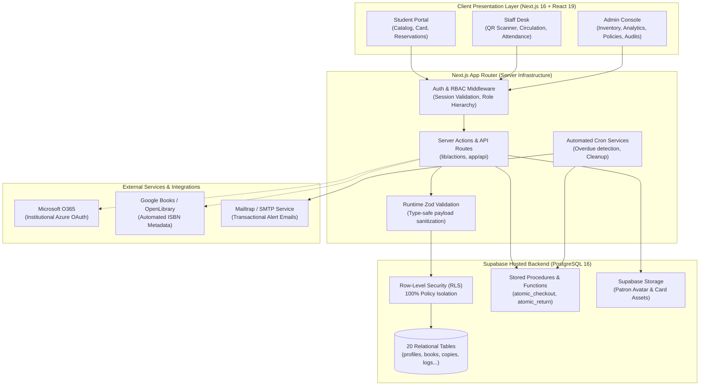

# Lumina LMS 📚

> **A Web-Based Library Book Reservation, Borrowing, and Inventory Management System with QR-Based Scanning for STI College Alabang**

[](https://nextjs.org/)
[](https://react.dev/)
[](https://www.typescriptlang.org/)
[](https://supabase.com/)
[](https://tailwindcss.com/)
[](https://vitest.dev/)
[](https://owasp.org/)

---

## 📑 Table of Contents

- [1. Executive Overview](#1-executive-overview)
- [2. Core Problem & Institutional Impact](#2-core-problem--institutional-impact)
- [3. Key Feature Modules](#3-key-feature-modules)
  - [3.1. High-Speed QR Circulation Desk](#31-high-speed-qr-circulation-desk)
  - [3.2. Dynamic Digital Library Cards](#32-dynamic-digital-library-cards)
  - [3.3. Master Bibliographic Catalog & Copy-Level Inventory](#33-master-bibliographic-catalog--copy-level-inventory)
  - [3.4. Contactless Attendance & Gatekeeping](#34-contactless-attendance--gatekeeping)
  - [3.5. Executive Analytics & Visual Reporting](#35-executive-analytics--visual-reporting)
  - [3.6. Administrative Governance, Policies & Audit Trails](#36-administrative-governance-policies--audit-trails)
  - [3.7. Automated Alerts & Background Maintenance](#37-automated-alerts--background-maintenance)
- [4. Role-Based Access Control (RBAC) Matrix](#4-role-based-access-control-rbac-matrix)
- [5. System Architecture & Data Flow](#5-system-architecture--data-flow)
- [6. Database Architecture & Relational Schema](#6-database-architecture--relational-schema)
- [7. Technology Stack](#7-technology-stack)
- [8. Repository Directory Structure](#8-repository-directory-structure)
- [9. Getting Started & Local Setup](#9-getting-started--local-setup)
  - [Prerequisites](#prerequisites)
  - [Installation Steps](#installation-steps)
  - [Database Initialization & Migrations](#database-initialization--migrations)
  - [Seeding Data](#seeding-data)
  - [Running the Application](#running-the-application)
- [10. Evaluation & Presentation Demo Credentials](#10-evaluation--presentation-demo-credentials)
- [11. Environment Configuration Reference](#11-environment-configuration-reference)
- [12. Testing & Quality Assurance](#12-testing--quality-assurance)
- [13. NPM Scripts Cheatsheet](#13-npm-scripts-cheatsheet)
- [14. Academic Attribution & License](#14-academic-attribution--license)

---

## 1. Executive Overview

**Lumina LMS** is an enterprise-grade, cloud-native Library Management System engineered specifically to address the operational and logistical requirements of **STI College Alabang**. 

Developed as a capstone thesis project, Lumina modernizes traditional library infrastructure through a unified digital platform. It combines sub-second **QR-based scanning** for patron circulation and attendance gatekeeping, real-time book reservation queues, automated bibliographic metadata retrieval via ISBN APIs, granular copy-level inventory tracking, and tamper-evident administrative auditing backed by PostgreSQL Row-Level Security (RLS).

```
┌────────────────────────────────────────────────────────────────────────┐
│                              Lumina LMS                                │
│   ┌──────────────────┐  ┌──────────────────┐  ┌────────────────────┐   │
│   │ QR Circulation   │  │ 20 PostgreSQL    │  │ 4 Institutional    │   │
│   │ Sub-second scans │  │ Tables + RLS     │  │ Role Personas      │   │
│   └──────────────────┘  └──────────────────┘  └────────────────────┘   │
│   ┌──────────────────┐  ┌──────────────────┐  ┌────────────────────┐   │
│   │ 3D Flip Library  │  │ Automated ISBN   │  │ 1,060+ Automated   │   │
│   │ Card + QR Export │  │ Metadata Lookup  │  │ Vitest Tests       │   │
│   └──────────────────┘  └──────────────────┘  └────────────────────┘   │
└────────────────────────────────────────────────────────────────────────┘
```

---

## 2. Core Problem & Institutional Impact

Traditional academic libraries often struggle with operational bottlenecks, resulting in:
1. **Circulation Bottlenecks:** Manual ledger handwriting and card lookups cause long queues during peak book borrowing and returning hours.
2. **Attendance Inaccuracies:** Paper-based entrance logs lead to illegible handwriting, skipped sign-ins, and inaccurate daily visitor metrics.
3. **Inventory Blindspots:** Disconnect between title-level catalog counts and the actual physical condition/shelf status of individual book copies.
4. **Reservation Friction:** Students cannot inspect real-time shelf availability from their devices or place reservations before physically visiting the library.
5. **Security & Accountability Deficits:** Lack of immutable audit trails leaves collection modifications, role promotions, and record overrides unmonitored.

**Lumina LMS** resolves these challenges by introducing:
- **Instant Optical Identification:** Instant camera and handheld QR scanning linking student ID tokens directly to specific physical copy barcodes.
- **Dual-Level Catalog Hierarchy:** Strict separation between master bibliographic records and unique physical copies (`AVAILABLE`, `BORROWED`, `RESERVED`, `MAINTENANCE`, `LOST`).
- **Zero-Trust Access Governance:** 4-tier Role-Based Access Control enforced at database row level via PostgreSQL RLS policies.
- **Automated Communication:** Scheduled cron background tasks triggering real-time in-app alerts and automated transactional email dispatch for due date warnings and hold availability.

---

## 3. Key Feature Modules

### 3.1. High-Speed QR Circulation Desk
- **Hardware & Web Camera Compatibility:** Operates seamlessly using integrated device webcams or dedicated handheld optical USB barcode scanners via `html5-qrcode`.
- **Sub-Second Processing:** Automatically associates borrower profiles with physical copy records upon scanning, validating loan eligibility and limits in real time.
- **Anti-Replay Idempotency:** Implements cryptographic transaction token tables (`checkout_idempotency`, `return_idempotency`) to prevent duplicate transactions during network instability or rapid re-scans.
- **Atomic Database RPCs:** Leverages stored procedures (`atomic_checkout`, `atomic_return`) guaranteeing ACID compliance during high-concurrency circulation desks.

### 3.2. Dynamic Digital Library Cards
- **3D Interactive Card Flip:** Interactive patron card component with smooth 3D CSS and Framer Motion transitions between front credentials and reverse barcode/QR sides.
- **Client-Side Asset Generation:** Generates scannable QR tokens representing patron credentials with client-side PNG image export powered by `html-to-image`.
- **Patron Status Lifecycle:** Displays real-time status indicators (`ACTIVE`, `PENDING`, `SUSPENDED`, `EXPIRED`, `ARCHIVED`) and academic program credentials.

### 3.3. Master Bibliographic Catalog & Copy-Level Inventory
- **Automated ISBN Fetching:** Integrated background lookup querying Google Books and Open Library APIs to auto-populate book titles, authors, descriptions, and cover art.
- **Dewey Decimal & Shelf Classification:** Full classification support with category tagging, call numbers, and physical section/aisle shelf assignments.
- **Fractional Availability Indicators:** Live badge calculation displaying fractional copy availability (e.g., `3 / 5 Available`) with automatic status toggling.
- **Batch Catalog Operations:** Drag-and-drop inventory spreadsheet importing (`.xlsx`, `.csv`) via SheetJS, sequential ISBN fallback lookups, and customizable data exports (`Spreadsheet`, `CSV`, `JSON`, `ZIP` cover packages).

### 3.4. Contactless Attendance & Gatekeeping
- **Kiosk Scanner Interface:** Dedicated entrance and exit gate interface for scanning physical or digital library cards upon entry and departure.
- **Dwell Time Computation:** Automatically logs exact entry and exit timestamps, calculating patron visit durations and peak occupancy windows.
- **Historical Attendance Timeline:** Chronological visit log accessible by patrons and library administration for verification and accreditation metrics.

### 3.5. Executive Analytics & Visual Reporting
- **Dynamic Time Filters:** Granular filtering across **7-Day**, **30-Day**, and **1-Year** intervals.
- **Real-Time Summary Counters:** KPI tiles tracking Daily Visitor Traffic, Active Loans, Total Collection Size, and Registered Patrons.
- **Interactive Recharts Visualizations:**
  - *Circulation Trends & Footfall:* Temporal line charts mapping checkout velocity against student gate visits.
  - *Genre Popularity & Distribution:* Interactive category allocation charts illustrating student reading preferences.
  - *Demand Leaderboard:* Ranked leaderboards highlighting top-circulated books and patron reading trends.

### 3.6. Administrative Governance, Policies & Audit Trails
- **Immutable Audit Logging:** Captures all administrative state mutations, role changes, and catalog updates with field-level JSON diffs (`before` vs. `after`).
- **Policy Control Panel:** Real-time configuration of maximum loan durations, reservation pickup windows, loan limits, fine structures, and academic program registries.
- **Campus Bulletin & Announcements:** Campus-wide announcement broadcasting banner system with urgency levels (`low`, `medium`, `high`, `critical`).
- **User Directory & Onboarding:** Comprehensive patron lifecycle management, approving pending student accounts and provisioning staff privileges.

### 3.7. Automated Alerts & Background Maintenance
- **In-App Notification Center:** Unread alert counter and interactive dropdown panel categorized by notification types (`CIRCULATION`, `RESERVATION`, `OVERDUE`, `SYSTEM`).
- **Automated Maintenance Cron (`/api/cron`):** Authenticated scheduled endpoint invoked via Vercel Cron to flag overdue records, expire unclaimed reservations, and dispatch transactional notifications.
- **Transactional Email Dispatch:** Automated email delivery via Nodemailer and Mailtrap SMTP for due date reminders and reservation hold notices.

---

## 4. Role-Based Access Control (RBAC) Matrix

Lumina enforces strict role boundary segregation across four distinct user tiers:

| System Capability | Super Admin (`super_admin`) | Librarian (`librarian`) | Student Assistant (`student_assistant`) | Student Patron (`student`) |
| :--- | :---: | :---: | :---: | :---: |
| **System Settings & Policies** | ✅ Full Access | ✅ Limits & Announcements | ❌ No Access | ❌ No Access |
| **Database Resets & Testing Tools** | ✅ Full Access | ❌ No Access | ❌ No Access | ❌ No Access |
| **Immutable Audit Logs & Diffs** | ✅ Full Access | ❌ Restricted | ❌ No Access | ❌ No Access |
| **User Directory & Account Roles** | ✅ Full Management | ✅ Student Statuses | ❌ No Access | ❌ No Access |
| **Analytics & Trend Reports** | ✅ Full Access | ✅ Full Access | ❌ No Access | ❌ No Access |
| **Catalog Batch Operations (Import/Export)**| ✅ Full Access | ✅ Full Access | ❌ No Access | ❌ No Access |
| **Copy Inventory Management** | ✅ Full Access | ✅ Full Access | 👁️ View-Only | ❌ No Access |
| **Circulation Desk (Issue / Return)** | ✅ Full Access | ✅ Full Access | ✅ Full Access | ❌ No Access |
| **Attendance Gate Scanning** | ✅ Full Access | ✅ Full Access | ✅ Full Access | ❌ No Access |
| **Public Book Catalog & Holds** | ✅ Full Access | ✅ Full Access | ✅ Full Access | ✅ Reserve for Pickup |
| **Digital Library Card & QR Export** | 👁️ Profile Card | 👁️ Profile Card | 👁️ Profile Card | ✅ Interactive Card + QR |
| **Personal Borrow & Attendance Logs** | 👁️ Self View | 👁️ Self View | 👁️ Self View | ✅ Dedicated Timeline |

---

## 5. System Architecture & Data Flow



---

## 6. Database Architecture & Relational Schema

The PostgreSQL database contains **20 public tables** designed with strict referential integrity, foreign key cascading controls, domain check constraints, and 100% Row-Level Security policy coverage:

```
                          ┌───────────────────────────┐
                          │       auth.users          │
                          └─────────────┬─────────────┘
                                        │ 1:1
                                        ▼
┌──────────────────┐      ┌───────────────────────────┐      ┌──────────────────┐
│  library_cards   │◄────┤     public.profiles       ├────►│    attendance    │
└──────────────────┘      └─────────────┬─────────────┘      └──────────────────┘
                                        │
           ┌────────────────────────────┼───────────────────────────┐
           ▼                            ▼                           ▼
┌──────────────────┐      ┌───────────────────────────┐   ┌──────────────────┐
│  notifications   │      │    borrowing_records      │   │   reservations   │
└──────────────────┘      └─────────────▲─────────────┘   └─────────▲────────┘
                                        │                           │
                                        │ N:1                       │ N:1
                          ┌─────────────┴─────────────┐             │
                          │       book_copies         ├─────────────┘
                          └─────────────▲─────────────┘
                                        │ N:1
                          ┌─────────────┴─────────────┐
                          │          books            │
                          └─────────────▲─────────────┘
                                        │ N:1
                          ┌─────────────┴─────────────┐
                          │        categories         │
                          └───────────────────────────┘
```

### Table Catalog Overview

| # | Table Name | Topological Dependencies | Primary Key | Key Domain Purpose |
|---|---|---|---|---|
| 1 | `categories` | None | `UUID` | Master taxonomy of disciplines, genre slugs, and shelf classifications. |
| 2 | `books` | `categories` | `UUID` | Master bibliographic catalog (title, author, ISBN, Dewey Decimal, cover URL). |
| 3 | `book_copies` | `books` | `UUID` | Physical inventory units with unique copy numbers, barcodes, and condition statuses. |
| 4 | `profiles` | `auth.users` | `UUID` | Extended patron profiles, student ID, program, clearance role, and status. |
| 5 | `library_cards` | `profiles` | `UUID` | Physical/digital library card tokens, barcodes, and expiration dates. |
| 6 | `borrowing_records`| `profiles`, `book_copies` | `UUID` | Complete circulation loan lifecycle, due dates, renewal counts, and return stamps. |
| 7 | `reservations` | `profiles`, `books`, `book_copies` | `UUID` | Hold queue items with prioritized positioning and fulfillment statuses. |
| 8 | `attendance` | `profiles` | `UUID` | Campus/library entrance and exit records with calculated dwell durations. |
| 9 | `audit_logs` | None (`admin_id` logical) | `UUID` | Tamper-evident administrative action log capturing detailed JSON before/after diffs. |
| 10 | `system_settings` | `profiles` | `UUID` | Dynamic operational configurations (loan duration, reservation expiration, limits). |
| 11 | `announcements` | `profiles` | `UUID` | Campus-wide broadcast bulletins and announcements with priority tagging. |
| 12 | `notifications` | `profiles` | `UUID` | Patron notification records with read/unread statuses and direct link targets. |
| 13 | `reports` | `books`, `profiles` | `UUID` | Patron-submitted asset issue and missing book verification reports. |
| 14 | `ui_preferences` | `profiles` | `UUID` | User interface preference toggles (theme, density, audio alerts). |
| 15 | `checkout_idempotency` | None | `UUID` | Cryptographic anti-replay cache preventing double-checkout transactions. |
| 16 | `return_idempotency` | None | `UUID` | Anti-replay token cache safeguarding atomic book returns. |
| 17 | `checklist_items` | None | `UUID` | Enterprise QA and verification state tracking items. |
| 18 | `checklist_dropdown_options` | None | `UUID` | Dynamic configuration options for institutional verification items. |
| 19 | `maintenance_tasks` | None | `UUID` | Operational maintenance task execution logs and health checks. |
| 20 | `user_roles` | `profiles` | `UUID` | Explicit RBAC privilege mapping and permission assignment. |

---

## 7. Technology Stack

### Frontend Architecture
- **Framework:** [Next.js 16.2.6](https://nextjs.org/) (React 19, Server Actions, App Router architecture)
- **Language:** [TypeScript 5.x](https://www.typescriptlang.org/) (Strict mode enabled)
- **Styling:** [Tailwind CSS 3.4](https://tailwindcss.com/) with CSS Variables & Dark Mode support
- **UI Primitives:** Radix UI (`@radix-ui/react-dialog`, `@radix-ui/react-dropdown-menu`, `@radix-ui/react-tabs`, `@radix-ui/react-avatar`, etc.)
- **Animations:** [Framer Motion 12.x](https://www.framer.com/motion/)
- **Icons:** [Lucide React](https://lucide.dev/)
- **Data Visualization:** [Recharts 3.8](https://recharts.org/)
- **Notifications & Feedback:** [Sonner](https://sonner.emilkowal.ski/)
- **Hardware & Barcode Scanning:** `html5-qrcode` & `qrcode`
- **Asset Processing & Export:** `html-to-image`, `sharp`, `xlsx` (SheetJS), `jszip`

### Backend & Cloud Infrastructure
- **Database & Identity:** [Supabase](https://supabase.com/) (Managed PostgreSQL 15/16, RLS, Storage Buckets, Auth)
- **Data Access Layer:** `@supabase/ssr` (Cookie-based session synchronization) & `@supabase/supabase-js`
- **Validation:** [Zod 4.x](https://zod.dev/) for type-safe server action and API payload parsing
- **Email Infrastructure:** [Nodemailer](https://nodemailer.com/) with Mailtrap SMTP sandbox integration
- **Scheduled Workers:** Vercel Cron invoking authenticated `/api/cron` maintenance routes
- **Deployment Platform:** Vercel Edge & Serverless Functions

### Testing & Quality Assurance
- **Test Runner:** [Vitest 4.1.7](https://vitest.dev/) with JSDOM and V8 Coverage
- **Testing Utilities:** `@testing-library/react`, `@testing-library/jest-dom`
- **Dead Code Detection:** [Knip 6.7](https://knip.dev/)
- **Linter & Formatting:** [ESLint 9](https://eslint.org/)

---

## 8. Repository Directory Structure

```
thesis/
├── app/                                # Next.js 16 App Router
│   ├── (auth)/                         # Unauthenticated auth routes (login, forgot-password)
│   ├── (authenticated)/                # Protected enterprise application workspace
│   │   ├── analytics/                  # Executive analytical reporting & Recharts
│   │   ├── attendance/                 # Contactless gate check-in & check-out scanner
│   │   ├── audit/                      # Immutable administrative audit logs & diff viewer
│   │   ├── borrow/                     # Patron borrowing records & active loans
│   │   ├── catalog/                    # Master book catalog with reservation holds
│   │   ├── circulation/                # Front-desk QR checkout & return desk
│   │   ├── dashboard/                  # Role-adaptive analytics & action dashboard
│   │   ├── history/                    # Global borrowing transaction history
│   │   ├── inventory/                  # Copy-level inventory & batch spreadsheet operations
│   │   ├── notifications/              # Dedicated patron alert management center
│   │   ├── operations/                 # Backend administrative maintenance actions
│   │   ├── policies/                   # Institutional rules, limits, and program lists
│   │   ├── profile/                    # Patron profile & interactive 3D digital library card
│   │   ├── return/                     # Dedicated book return terminal
│   │   └── users/                      # User directory & patron onboarding management
│   ├── api/                            # Next.js Server Route Handlers
│   │   ├── admin/                      # Administrative API endpoints (categories, users)
│   │   ├── circulation/                # Circulation scanning & transaction handlers
│   │   ├── cron/                       # Automated maintenance worker (Vercel Cron)
│   │   └── notifications/              # In-app alert dispatch and status mutations
│   ├── globals.css                     # Global design tokens and Tailwind directives
│   └── layout.tsx                      # Root HTML layout with providers and fonts
├── components/                         # Modular React components
│   ├── auth/                           # Authentication forms & onboarding dialogs
│   ├── catalog/                        # Book cards, detail modals & search filters
│   ├── circulation/                    # QR scanner wizards, confirmation panels
│   ├── dashboard/                      # Real-time KPI metric tiles and galleries
│   ├── inventory/                      # Batch import/export modals & copy tables
│   ├── layout/                         # Header, protected sidebars (ProtectedNav)
│   ├── profile/                        # 3D Flip Digital Library Card & export tools
│   └── ui/                             # Standardized Radix-based UI design system
├── lib/                                # Business logic & data-access abstractions
│   ├── actions/                        # Next.js Server Actions (circulation, catalog, users)
│   ├── auth/                           # RBAC role permissions matrix & access guards
│   ├── supabase/                       # Supabase client/server session helpers
│   ├── validations/                    # Zod schemas for input validation
│   ├── mail.ts                         # Nodemailer SMTP transactional notification service
│   └── logger.ts                       # Structured logging & audit utilities
├── public/                             # Static assets, branding, and icons
├── scripts/                            # Operational database tooling
│   ├── clean.ts                        # Safe database purge & cleanup script
│   └── seed.ts                         # Comprehensive enterprise database seed script
├── supabase/                           # Database architecture & migration scripts
│   ├── config.toml                     # Supabase CLI local configuration
│   ├── sample_data.sql                 # Sample SQL query scripts
│   └── schema_clean_install.sql        # Canonical 20-table DDL migration schema + RLS
├── test/                               # Automated Vitest test suites (1,060+ tests)
│   ├── actions-circulation-adversarial.test.ts
│   ├── challenger-m1-adversarial.test.tsx
│   ├── challenger-m2-rls-hardening.test.ts
│   └── role-by-role-execution.test.ts
├── types/                              # Canonical TypeScript definitions & Supabase DB types
├── package.json                        # Project dependencies, engines & scripts
├── next.config.ts                      # Next.js production configuration & CSP headers
└── vitest.config.ts                    # Vitest test framework configuration
```

---

## 9. Getting Started & Local Setup

### Prerequisites
- **Node.js:** `24.x` (LTS recommended)
- **Package Manager:** `npm >= 11.x`
- **Supabase Account / CLI:** [Supabase Project](https://supabase.com/) or local Supabase CLI instance
- **SMTP Provider (Optional for Emails):** [Mailtrap](https://mailtrap.io/) sandbox account for local email testing

### Installation Steps

1. **Clone the repository:**
   ```bash
   git clone https://github.com/Godwynski/thesis.git
   cd thesis
   ```

2. **Install project dependencies:**
   ```bash
   npm install
   ```

3. **Configure Environment Variables:**
   Copy the provided environment template to `.env.local`:
   ```bash
   cp .env.example .env.local
   ```
   Open `.env.local` and populate your Supabase and SMTP keys (see [Environment Configuration Reference](#11-environment-configuration-reference)).

### Database Initialization & Migrations

If setting up a fresh database on Supabase:
1. Navigate to the **SQL Editor** in your Supabase Dashboard (or use `supabase db push` if using the CLI).
2. Execute the entire contents of [`supabase/schema_clean_install.sql`](file:///c:/Users/Godwyn/Documents/Projects/thesis/supabase/schema_clean_install.sql).
3. This creates all **20 relational tables**, custom enums, stored procedures (`atomic_checkout`, `atomic_return`), full-text search indexes, and hardened Row-Level Security policies.

### Seeding Data

To populate the database with comprehensive catalog categories, real-world academic books, physical copies, sample circulation transactions, and role-based test accounts:

```bash
npm run seed
```

> **Note:** To reset and purge test records in the database, run `npm run clean`.

### Running the Application

Start the local Next.js development server:

```bash
npm run dev
```

Open [http://localhost:3000](http://localhost:3000) in your web browser.

---

## 10. Evaluation & Presentation Demo Credentials

For thesis presentation defenses, stakeholder reviews, and evaluative demonstrations, the landing page includes pre-configured **Quick Demo Access** accounts with full role access:

| Role Persona | Demo Email | Default Password | Initial View / Clearance Scope |
| :--- | :--- | :---: | :--- |
| **Super Administrator** | `admin@lumina.test` | `Password123!` | Full administrative dashboard, audit logs, system policies, database maintenance tools. |
| **Librarian** | `librarian@lumina.test` | `Password123!` | Collection cataloging, patron approvals, circulation desks, inventory spreadsheets, and analytics. |
| **Student Assistant (Staff)** | `staff@lumina.test` | `Password123!` | Front-desk circulation scanning, attendance gate logging, catalog searching, personal loan log. |
| **Student Patron** | `student@lumina.test` | `Password123!` | Digital 3D Library Card with QR export, book hold reservations, active borrowing timeline, FAQs. |

> **Production Deployment Notice:** In live production environments, these demo login buttons and test credentials should be gated or removed by setting `process.env.NODE_ENV === 'production'`.

---

## 11. Environment Configuration Reference

The application requires the following environment variables defined in `.env.local`:

| Variable Name | Required | Scope | Description |
| :--- | :---: | :---: | :--- |
| `NEXT_PUBLIC_SUPABASE_URL` | **Yes** | Client / Server | The HTTPS endpoint of your Supabase project (e.g., `https://xxxx.supabase.co`). |
| `NEXT_PUBLIC_SUPABASE_PUBLISHABLE_KEY` | **Yes** | Client / Server | Safe public anonymous API key for client-side Supabase authentication. |
| `SUPABASE_SERVICE_ROLE_KEY` | **Yes** | Server Only | Privileged secret key used by server actions and cron workers. **Never expose to the client.** |
| `CRON_SECRET` | **Yes** | Server Only | High-entropy shared secret used to authorize automated maintenance calls to `/api/cron`. |
| `NEXT_PUBLIC_SITE_URL` | Optional | Client / Server | Canonical public URL used for absolute image paths and transactional email links. |
| `NEXT_PUBLIC_CARD_ASSET_BUCKET` | Optional | Client / Server | Supabase Storage bucket name for generated patron ID card assets (default: `library-cards`). |
| `SMTP_HOST` | Optional | Server Only | Outgoing SMTP server hostname (default: `sandbox.smtp.mailtrap.io`). |
| `SMTP_PORT` | Optional | Server Only | Outgoing SMTP server port (default: `2525`). |
| `SMTP_USER` | Optional | Server Only | Username credential for the SMTP service. |
| `SMTP_PASS` | Optional | Server Only | Password credential for the SMTP service. |
| `SMTP_FROM` | Optional | Server Only | Default sender email header (e.g., `"Lumina Library <noreply@lumina-lms.com>"`). |

---

## 12. Testing & Quality Assurance

Lumina LMS includes an extensive automated test suite consisting of **48 test files** and **1,060+ unit, integration, and adversarial tests** verifying system invariants:

```bash
# Execute the full automated Vitest test suite
npm run test

# Run tests in interactive watch mode
npm run test:watch

# Generate code coverage report (V8 engine)
npm run test:coverage

# Perform TypeScript compile-time type validation
npm run typecheck

# Execute ESLint static code analysis
npm run lint

# Scan for dead code, unused dependencies, and orphaned exports
npx knip
```

### Key Test Categories
- **Adversarial Circulation Tests (`test/actions-circulation-adversarial.test.ts`):** Verifies that concurrent checkouts, borrow limit overflows, and already-loaned copy requests are safely rejected.
- **RLS & Security Hardening (`test/challenger-m2-rls-hardening.test.ts`):** Validates that student patrons cannot read administrative tables or modify records belonging to other users.
- **Relational Invariants & Triggers (`test/challenger-m1-constraints.test.ts`):** Assures that negative copy quantities, invalid due dates, and unlinked transactions are rejected by database check constraints.
- **Navigation & Loading Skeletons (`test/navigation-and-loading-states.test.ts`):** Guarantees that all route-level loading skeletons and accessible navigation elements render cleanly.

---

## 13. NPM Scripts Cheatsheet

| Command | Action / Purpose |
| :--- | :--- |
| `npm run dev` | Starts the Next.js development server at [http://localhost:3000](http://localhost:3000) |
| `npm run build` | Compiles the production build with asset optimization |
| `npm run start` | Boots the compiled Next.js production server |
| `npm run test` | Runs all 1,060+ Vitest test suites once |
| `npm run test:watch` | Starts Vitest in interactive file-watching mode |
| `npm run test:coverage` | Measures unit and integration code coverage via V8 |
| `npm run lint` | Runs ESLint to check for stylistic and syntax errors |
| `npm run typecheck` | Invokes the TypeScript compiler (`tsc --noEmit`) to verify types |
| `npm run analyze` | Analyzes client and server bundle sizes via `@next/bundle-analyzer` |
| `npm run seed` | Seeds the database with categories, books, copies, and test patrons |
| `npm run clean` | Purges transactional test records from the Supabase database |

---

## 14. Academic Attribution & License

- **Institution:** STI College Alabang
- **Academic Program:** Bachelor of Science in Information Technology / Computer Science
- **Project Title:** *Lumina: A Web-Based Library Book Reservation, Borrowing, and Inventory Management System with QR-Based Scanning for STI College Alabang*
- **License:** Proprietary — Developed solely for academic capstone presentation, institutional evaluation, and operational implementation at STI College Alabang.

---

<p align="center">
  <b>Lumina LMS</b> • Crafted with excellence for STI College Alabang • 2026
</p>
